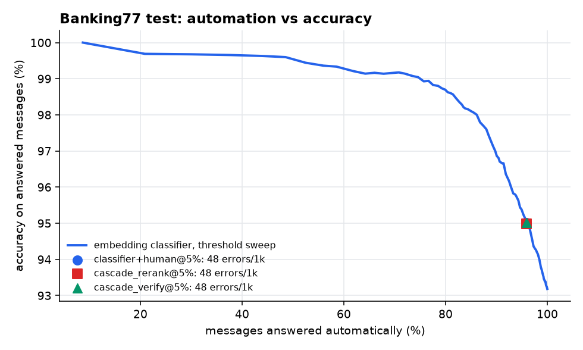

# bank-intent-cascade: when is an LLM actually worth it?

A bank's support inbox gets messages like *"my top-up was reverted, why?"*. They must be routed to one of 77 intents.
This project builds that router three ways and measures them on the same held-out test set:

1. **Classifier**: sentence embeddings (bge-small, 33M params) + logistic regression.
2. **Cascade**: the classifier answers when it is confident; a **local LLM** (Qwen2.5-3B, llama.cpp, CPU) decides the
   uncertain middle band; the least confident messages go to a **human**.
3. **Classifier + human only**: the same confidence threshold, but no LLM band.

**Result: on this task the LLM did not pay for itself.** Classifier + calibrated human hand-off cut customer-facing
errors by 30–59%. Adding the LLM band changed nothing measurable, while each LLM call cost 9 s and ~390 prompt tokens.
The service therefore ships with the LLM band switched off, and the cascade code stays in place for a stronger model.



## Results (Banking77 test, 3,080 messages; every threshold tuned on validation, reported once on test)

| Policy | Answered automatically | Sent to human | Accuracy on answered | Errors per 1,000 msgs (95% CI) | Mean latency |
|---|---:|---:|---:|---:|---:|
| TF-IDF + LR, answer everything | 100% | 0% | 88.57% | 114.3 (102.9–125.3) | <1 ms |
| Embedding + LR, answer everything | 100% | 0% | 93.18% | 68.2 (59.4–77.3) | 28 ms |
| **Embedding + LR + human, budget 5%** | 95.9% | 4.1% | 95.02% | **47.7 (40.6–54.9)** | 28 ms |
| Cascade (LLM rerank) + human, budget 5% | 95.3% (+0.6% LLM) | 4.1% | 94.99% | 48.1 (40.7–55.5) | 83 ms |
| **Embedding + LR + human, budget 10%** | 90.1% | 9.9% | 96.86% | **28.2 (22.7–34.4)** | 28 ms |

LLM on its own band (232 test messages with classifier confidence < 0.5): **59.5%** correct vs **56.5%** for the
classifier on the same messages. That is +3 pts, at **p50 9.0 s / p95 17.3 s per call** on a laptop CPU.
Zero-shot over all 77 intents (no classifier): **32.5%** on 40 random messages. Raw probe numbers are in
[reports/llm_probes.md](reports/llm_probes.md).

Other measurements:

| | |
|---|---|
| Classifier calibration (ECE, test) | 0.076 (TF-IDF: 0.165) |
| Gold intent inside classifier top-5 | 99.25% |
| Service end-to-end latency (HTTP + embedding + LR, 1 worker, laptop CPU) | p50 51 ms · p95 68 ms · p99 84 ms · ~19 req/s |
| Most confused intents | *pending transfer → transfer timing* (6), *pending transfer → transfer not received* (5), *top up reverted → top up failed* (4) |

## How it works

```
message ──► bge-small embedding ──► logistic regression ──► confidence c
                                                     │
              c ≥ t_auto ─────────────────────────────┼──► answer (≈28 ms)
              t_llm ≤ c < t_auto (only below 0.5) ────┼──► local LLM picks among top-5 intents,
                                                     │    shown 3 real training examples per option
              c < t_llm ──────────────────────────────┴──► human agent
```

LLM engineering details:
- **Constrained decoding.** A GBNF grammar allows only the option numbers, so there are 0 parse failures by construction.
- **Retrieval-augmented few-shot.** For each candidate intent the prompt shows the 3 training messages nearest to the
  customer's message. This raised the 3B model from 25% to 45% on the hardest validation messages.
- **KV-cache reuse.** In zero-shot mode the 77-label list is the system prompt, so only the customer message is
  re-processed after the first call (first call 19–22 s, later calls 1.1–3.8 s).
- **Cost bounded by design.** The LLM band can never sit above confidence 0.5, so at most ~8% of traffic could
  ever reach the LLM.

## Run it

```bash
python -m venv .venv && .venv\Scripts\activate          # Windows; Linux/macOS: source .venv/bin/activate
pip install torch --index-url https://download.pytorch.org/whl/cpu
pip install -r requirements.txt
pip install llama-cpp-python --extra-index-url https://abetlen.github.io/llama-cpp-python/whl/cpu
python -c "from huggingface_hub import hf_hub_download as d; d('Qwen/Qwen2.5-3B-Instruct-GGUF','qwen2.5-3b-instruct-q4_k_m.gguf', local_dir='models')"

python scripts/stage1_baselines.py                                   # classifiers (~3 min)
python scripts/stage2_llm.py qwen2.5-3b-instruct-q4_k_m.gguf 3 5     # LLM on the uncertain band (~1 h on CPU)
python scripts/stage3_report.py qwen2.5-3b-instruct-q4_k_m_s3_k5     # policies, CIs, figure -> reports/results.json
python scripts/train_classifier.py && uvicorn cascade.service:app    # POST /classify {"text": "..."}
pytest                                                               # 15 tests: policy logic + API contract
```

The LLM layer is one class (`cascade/llm.py`). Pointing it at a hosted model is the obvious next experiment.

## Design decisions (and why)

- **Start with the cheapest thing that could work.** TF-IDF and an embedding classifier came before any LLM. The
  embedding model brought errors from 114 to 68 per 1,000 at 28 ms. Every later step has to beat that.
- **Measure in "errors per 1,000 customers", not accuracy.** The business question is how many wrong answers reach
  customers at a given human workload. Accuracy on answered messages hides how much was handed off.
- **Tune on validation, report once on test.** The 15% validation split is carved from train (stratified). Thresholds
  never see test.
- **Bootstrap CIs before claiming a win.** 48.1 vs 47.7 errors/1k looks like a difference, but the CIs overlap almost
  completely, so the claim is "no measurable gain".
- **Ship the boring path.** The production service runs classifier + human only. Turning the LLM band on would cost
  ~3× mean latency and model-hosting money for no measured benefit.

## Known limits

- One local model family (Qwen2.5 1.5B/3B, 4-bit, CPU). A frontier API model would likely do better on the hard band.
  The pipeline is ready for that comparison; it was not run here because no API access was available.
- The human is assumed to resolve every hand-off correctly. Real agents also make mistakes.
- The service model is retrained on train+validation, so its confidence is slightly higher than the one used to tune
  thresholds: 2.8% of messages went to a human in the latency benchmark vs 4.1% expected.
- Banking77 is English. A Vietnamese bank would need its own labelled set.

## Interview questions this project prepares for

1. Why use errors per 1,000 instead of accuracy? What does each hide?
2. The LLM was +3 pts on its band. Why did that not show up end-to-end?
3. What would have to be true (accuracy, latency, price) for the LLM band to be worth switching on?
4. Why does few-shot with *nearest* examples help much more than intent names alone?
5. How would you detect drift in production, given you only see confidence, not labels?
